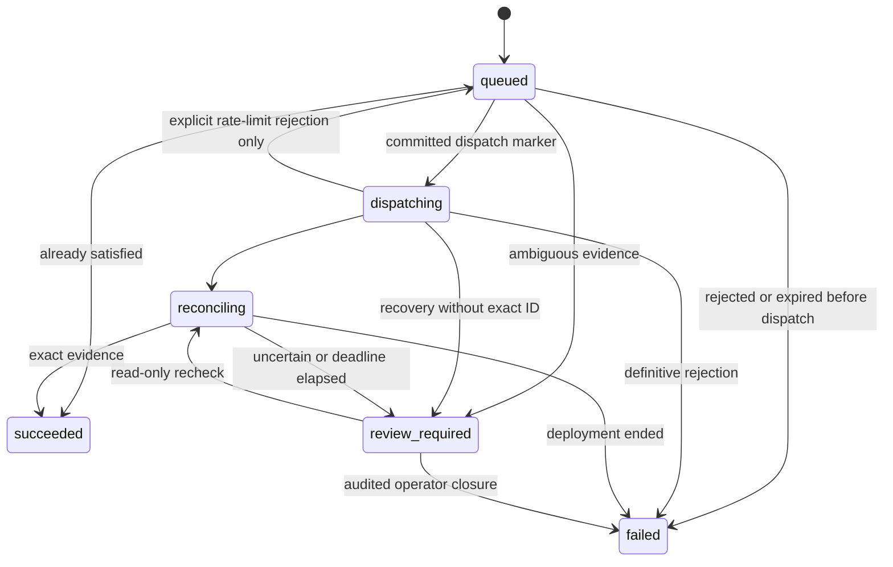

# Architecture and decisions

## Boundaries

The browser owns presentation and retry metadata, not provider truth. TanStack Query handles cancellation, polling, cache invalidation and query errors. `sessionStorage` retains only an interrupted request's UUID key, action and resource ID. No token, password or session credential is stored there.

Next.js serves the App Router UI and forwards `/api/*` to a configured internal origin. The Nest API is the security and domain boundary. Controllers validate/map transport values and delegate. Services authorize access and enforce lifecycle rules. Repositories own Sequelize reads, writes, locking and compare-and-swap conditions. DTOs expose shared Zod contracts rather than ORM entities.

The abstract `RailwayLifecycle` has two injectable implementations. The real adapter uses a fixed endpoint and fixed documents; a browser request cannot supply GraphQL, a service ID, an environment or a token. The simulator is explicitly selected with `PROVIDER_MODE=mock` and prominently labelled in the UI.

## Request lifecycle

1. Authenticate the session; validate origin, CSRF, body, route, query and idempotency key.
2. Start a database transaction and lock the owned managed-resource row.
3. Replay an existing `(actor_subject, idempotency_key)` only when its SHA-256 request fingerprint matches.
4. Reject a conflicting unresolved operation. Update intended state and increment its generation.
5. Insert the `queued` operation and commit. Only now return `202` and `Location`.
6. The tracked worker selects due work and reads fresh provider state.
7. If already satisfied, complete without a mutation. Incomplete/ambiguous state goes to review; drift, transitions and sleeping prevent dispatch.
8. Persist `dispatching`, dispatch time, baseline IDs and the exact stop target before calling Railway.
9. Persist the returned deployment ID and reconcile with read-only provider requests.
10. Record success only when corroborating evidence exists; otherwise defer, fail or require review.

`review_required` is unresolved and blocks new commands. A provider call and a database commit cannot be atomic. The marker intentionally prefers a stuck/reviewable request over a duplicate external side effect after a crash. No exactly-once guarantee is claimed.

## Three state dimensions

| Dimension | Meaning                                  | Example                           |
| --------- | ---------------------------------------- | --------------------------------- |
| Intended  | Latest accepted command                  | `running`                         |
| Observed  | Last provider evidence and its timestamp | `unknown`, or last seen `running` |
| Operation | Progress of a specific request           | `reconciling`, `review_required`  |

`SUCCESS` alone does not prove a running workload: a `RUNNING` instance must be present. Absence from a complete snapshot can mean stopped; an incomplete page cannot. Latest `FAILED`/`CRASHED` evidence is shown as failed. New or unrecognized provider statuses stay unknown. “Running” reports provider state, not an application health probe.

Observations use generation and sequence tickets. An older request cannot overwrite a newer request or intent; same-deployment provider timestamps cannot regress. A complete snapshot with no deployment can clear an old ID. Failed checks preserve the last good observation and attach a safe error. Evidence is stale after three minutes or immediately after a failed check.

## Persistence

- `managed_resources`: owner, allowlisted provider mapping, intended state, generation/revision, observation sequence and last evidence.
- `operations`: UUID, actor, action, idempotency/fingerprint, state, exact/baseline deployment IDs, deadlines, retry schedule, revision, failure/outcome and timestamps.
- `operation_reviews`: one explicit human closure per operation, reason, actor, time, prior revision and prior failure; saved atomically with closure.
- `sessions`: PostgreSQL-backed Passport session state with expiry.

Foreign keys prevent orphaned operation history. A partial unique index over unresolved states is the last line of defense against overlapping commands. History uses a bounded `(accepted_at, id)` keyset cursor, not an unbounded offset.

## Worker and budgets

One Nest process runs a tracked, single-concurrency loop at one-second scheduling intervals. A dedicated PostgreSQL connection owns an advisory leadership lock; no untracked request-scoped background promise is used. Shutdown awaits in-flight work. Lock-connection loss stops dispatch and fails readiness until restart.

Provider reads back off from 5 to 30 seconds; idle observation defaults to 120 seconds. A conservative local budget caps calls at 80/hour and honors provider `Retry-After` and remaining/reset headers. UI polling reads PostgreSQL and does not fan out to Railway. The default confirmation deadline is ten minutes. A budget delay can exceed that deadline and require review; it is never converted into an optimistic success.

The advisory lock is not provider fencing. A process/network partition can occur between its final ownership check and the external request. Deployment settings require a single API/worker replica; this implementation is not a general multi-worker scheduler. Local rate budgets reset on process restart.

## Security

- Passport Local verifies one configured Argon2id principal. Login regenerates the session and CSRF token; logout destroys the session.
- Cookie: HttpOnly, SameSite=Strict, eight-hour lifetime; production adds Secure and the `__Host-` prefix.
- Every unsafe request requires the exact configured Origin, JSON content type and a session-bound CSRF token. CORS is not opened to arbitrary origins.
- Resource reads, history, commands, operation reads and Swagger are authenticated. Scope is checked against the configured mapping and persisted owner on every access.
- JSON bodies are limited to 16 KiB. Per-IP limits: 5 login attempts/minute, 10 writes/10 minutes, 180 reads/minute. The bounded limiter is process-local.
- Provider responses are Zod-validated. Raw upstream messages, headers, session secrets, passwords and stacks are not returned. Logs contain request/operation identifiers and safe classifications.
- Railway uses an environment-scoped project token, server-side only. Account-wide tokens are unnecessary for this design.

## Rejected alternatives

| Alternative                                       | Why rejected here                                                                                                  |
| ------------------------------------------------- | ------------------------------------------------------------------------------------------------------------------ |
| Browser calls Railway directly                    | Exposes provider credentials and bypasses ownership/durability rules                                               |
| A long synchronous POST until deployment finishes | Couples lifecycle progress to browser/proxy timeouts                                                               |
| In-memory queue or fire-and-forget promise        | Loses accepted work on restart                                                                                     |
| Redis/BullMQ plus PostgreSQL                      | Adds infrastructure and a dual-write problem for a one-resource demo; PostgreSQL is the durable queue              |
| Generic GraphQL proxy or arbitrary service IDs    | Expands authority far beyond the allowlisted workload                                                              |
| Retry every mutation after timeout                | A response can be lost after acceptance; duplicate deployments are possible                                        |
| Assume the newest deployment belongs to our start | External actors can create a deployment in the same interval                                                       |
| `serviceDelete` as Stop                           | Destroys the managed resource and configuration                                                                    |
| Native `deploymentStop` as a hidden fallback      | Different semantics and reported observation problems; explicit removal/new-deployment behavior is easier to audit |
| Autosync ORM schema in production                 | Cannot review, repeat or reason reliably about schema changes                                                      |
| Multi-tenant provisioning and horizontal workers  | Requires distributed limiting, fencing/leases, ownership management and a larger product surface                   |

## Deliberate limitations

Single principal and resource; no MFA/user lifecycle, distributed rate limiter, log viewer, SSE, external reachability check or automatic history retention. No automated drift repair, service creation, volume management or image changes. Provider configuration can change between observation and mutation. No external test has yet validated token permissions, removed-deployment visibility or real lifecycle timing. These are deployment gates, not assertions made by the simulator.
